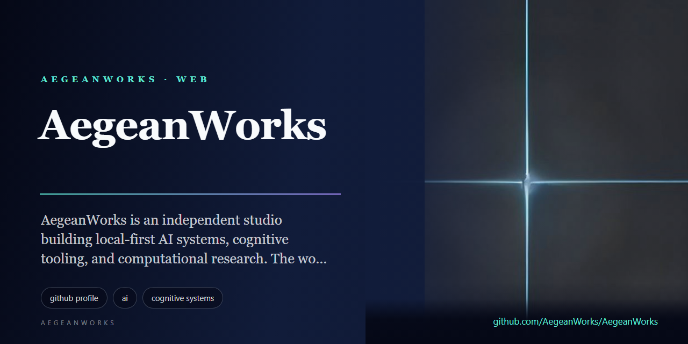
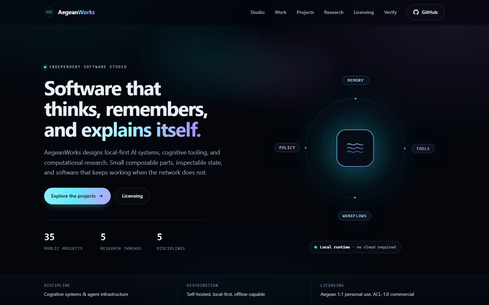

<!-- aegean:media:start -->
<p align="center"></p>
<!-- aegean:media:end -->
<p align="center">
</p>

<p align="center">
  <a href="https://aegeanworks.github.io/AegeanWorks/"></a>
  <a href="https://github.com/AegeanWorks/AIKit"></a>
  <a href="COMMERCIAL.md"></a>
  <a href="https://github.com/AegeanWorks?tab=repositories"></a>
</p>

<h3 align="center">We build software that thinks, remembers, and explains itself.</h3>

---

## What we build

AegeanWorks is an independent studio building **local-first AI systems**, **cognitive tooling**, and **computational research**. The work favors small composable parts, inspectable state, and software that still works when the network does not.

| Area | What it means in practice |
|---|---|
| **Cognitive systems** | Agent frameworks, tool routing, memory layers, and explicit belief control. |
| **Governed autonomy** | Delivery gates, audit trails, and disruption recovery for AI coding agents. |
| **Personal science** | N=1 experimentation, neuro-acoustics, and falsification-first research tooling. |
| **Playable systems** | Simulations, puzzles, and games built to make complex mechanics legible. |

---

## Featured systems

### [NeuroCore](https://github.com/AegeanWorks/NeuroCore)
A self-hosted, modular agent framework for persistent, tool-using autonomous systems. Workflows, long-term memory, RAG, and a plugin surface in one extensible runtime.

### [AIKit](https://github.com/AegeanWorks/AIKit)
Crash-resilient governance and delivery gates for AI coding agents: versioned task ledger, commit-level verification, secret scanning, and per-project gates.

### [N1-Engine](https://github.com/AegeanWorks/N1-Engine)
A local-first, privacy-focused platform for rigorous N-of-1 self-experimentation: apply scientific statistics to your own life data, on your own machine.

### [NeuralBeat](https://github.com/AegeanWorks/NeuralBeat)
A mathematically precise neuro-acoustic desktop app for binaural, monaural, and isochronic tones, with hardware-aware safety limits.

---

## Public project atlas

Every project repository below is public. Browse the full set on [GitHub](https://github.com/AegeanWorks?tab=repositories). The website's live atlas reads public repository titles, descriptions and topics from the GitHub API at page load; this snapshot remains the fallback for no-JavaScript readers and API failures. Each portfolio card carries the repository's own logo, and opens a local dossier with its social preview, metadata, commit-stamped screenshots when media exists, and a README excerpt, while the repository link remains one click away.

<details>
<summary><b>Cognitive AI &amp; Agent Infrastructure</b></summary>

| Project | Description |
|---|---|
| [NeuroCore](https://github.com/AegeanWorks/NeuroCore) | A self-hosted, modular AI agent framework for persistent, tool-using autonomous systems: workflows, long-term memory, RAG and a plugin architecture in one platform. Free personal use under AL-1.1; commercial use under ACL-1.0. |
| [AIKit](https://github.com/AegeanWorks/AIKit) | Crash-resilient governance and delivery gates for AI coding agents: versioned task ledger, commit-level verification, secret scanning and per-project gates. Free for personal use under AL-1.1; commercial use under ACL-1.0. |
| [Lacon](https://github.com/AegeanWorks/Lacon) | An AI that thinks in as few letters as possible, recursively over a long context: its own alphabet, budget, thinker and recursive engine. No network, no API key, no model weights; the core is standard library only. Free personal use under AL-1.1; commercial use under ACL-1.0. |
| [Lattice](https://github.com/AegeanWorks/Lattice) | A provenance-first research knowledge graph for humans and AI agents. Local-first, SQLite-backed and standard library only. Free personal use under AL-1.1; commercial use under ACL-1.0. |
| [Assay](https://github.com/AegeanWorks/Assay) | Tamper-evident audit evidence for AI agents: a local-first hash-chained ledger, policy review, and offline-verifiable evidence packs. Free personal use under AL-1.1; commercial use under ACL-1.0. |
| [Aegean-Licensing](https://github.com/AegeanWorks/Aegean-Licensing) | The Aegean License family (AL, AGL and ASL 1.1) and the Aegean Commercial License: canonical texts, policies, commercial templates and certificate verification tooling for AegeanWorks projects. |

</details>

<details>
<summary><b>Research &amp; Simulation</b></summary>

| Project | Description |
|---|---|
| [N1-Engine](https://github.com/AegeanWorks/N1-Engine) | A local-first, privacy-focused platform for rigorous N-of-1 self-experimentation: apply scientific statistics to your own life data, on your own machine. Free personal use under AL-1.1; commercial use under ACL-1.0. |
| [Fluid-Universe](https://github.com/AegeanWorks/Fluid-Universe) | Falsification-first research codebase testing a Z3 circulant origin of the Koide lepton relation, with a separately labelled nematic-fluid UV speculation. Free non-commercial research under ASL-1.1; commercial use under ACL-1.0. |
| [PNN](https://github.com/AegeanWorks/PNN) | Oral, blood-brain barrier-penetrant agents that soften hypothalamic perineuronal nets to restore insulin signaling in obesity: research notes, data and computational analyses. Free non-commercial research under ASL-1.1; commercial use under ACL-1.0. |
| [Primordia](https://github.com/AegeanWorks/Primordia) | A zero-dependency evolution sandbox: seed a biosphere, run its clock, and watch genomes vary, compete and speciate. Every run replays exactly from its seed, and a fossil record keeps its history. Free personal use under AL-1.1; commercial use under ACL-1.0. |
| [Orrery](https://github.com/AegeanWorks/Orrery) | An N-body gravitational sandbox for the terminal or the browser: nine curated worlds, a symplectic integrator, optional relativity and collisions, live energy diagnostics, orbit trails and CSV/JSON export. Standard library only. Free non-commercial research under ASL-1.1; commercial use under ACL-1.0. |
| [Research-Engine](https://github.com/AegeanWorks/Research-Engine) | A falsification-first research engine that turns questions into provenance-backed claims, executable kill tests, and auditable verdicts. |
| [NeurologyClinicTemplates-TR](https://github.com/AegeanWorks/NeurologyClinicTemplates-TR) | Standardized Turkish anamnesis (patient history) templates for common neurology complaints, helping neurologists, residents and medical students document assessments completely and systematically. Free personal use under AL-1.1; commercial use under ACL-1.0. |

</details>

<details>
<summary><b>Health, Neuro &amp; Personal Tools</b></summary>

| Project | Description |
|---|---|
| [NeuralBeat](https://github.com/AegeanWorks/NeuralBeat) | A local-first neuro-acoustic desktop app that generates mathematically accurate binaural, monaural and isochronic tones for focus, meditation, relaxation and sleep. Free personal use under AL-1.1; commercial use under ACL-1.0. |
| [NeuroOptic](https://github.com/AegeanWorks/NeuroOptic) | A research-grade visual oscillator for brainwave entrainment: configurable 1-120 Hz frequencies, hardware-aware safety limits and drift-free phase accumulation. Free personal use under AL-1.1; commercial use under ACL-1.0. |
| [NeuralDeck](https://github.com/AegeanWorks/NeuralDeck) | An offline desktop app that turns PDFs, Word files and other documents into high-quality Anki flashcards with a local LLM, with smart deck matching, AI editing and direct Anki sync. Free personal use under AL-1.1; commercial use under ACL-1.0. |
| [NobetWizard](https://github.com/AegeanWorks/NobetWizard) | An automated duty roster generator built with Streamlit: fair monthly schedules under constraints such as gender, rest days and availability, with Excel and PDF export, in English and Turkish. Free personal use under AL-1.1; commercial use under ACL-1.0. |
| [Mnemo](https://github.com/AegeanWorks/Mnemo) | A dependency-free, local-first spaced-repetition flashcard CLI: study each card on the day the SM-2 algorithm says it is due, and keep everything in one readable JSON file on your machine. Free personal use under AL-1.1; commercial use under ACL-1.0. |
| [NoMoreClutter](https://github.com/AegeanWorks/NoMoreClutter) | An AI desktop app that organizes your files with large language models: it analyzes, categorizes and renames them with descriptive names, and works with local LLMs. Free personal use under AL-1.1; commercial use under ACL-1.0. |

</details>

<details>
<summary><b>Developer Tools &amp; Utilities</b></summary>

| Project | Description |
|---|---|
| [Chronos](https://github.com/AegeanWorks/Chronos) | A lightweight, local-first focus and session orchestrator for developers: track deep-work sessions, micro-milestones and interruptions, and get productivity insights. Python standard library only. Free personal use under AL-1.1; commercial use under ACL-1.0. |
| [Gauge](https://github.com/AegeanWorks/Gauge) | A zero-dependency terminal ruler for numeric series: read numbers from arguments, a file or a pipe and draw a sparkline, signed bars, a histogram, a box plot or a statistics block. stats --json feeds other tools. Free personal use under AL-1.1; commercial use under ACL-1.0. |
| [Tally](https://github.com/AegeanWorks/Tally) | A dependency-free, local-first expense ledger for the terminal: record what you spend, list it and see where the money went, all in one readable JSON file on your machine. Free personal use under AL-1.1; commercial use under ACL-1.0. |
| [Tempo](https://github.com/AegeanWorks/Tempo) | A focus timer you run on your own machine: one Python process, a browser page, no dependencies, no account and no network calls. Focus and break phases alternate, and every fourth break is a long one. Free personal use under AL-1.1; commercial use under ACL-1.0. |
| [Pebble](https://github.com/AegeanWorks/Pebble) | A tiny, dependency-free scripting language: lexer, parser, tree-walking evaluator and REPL. Built as an AIKit evaluation project, where the process is under test as much as the code. Free personal use under AL-1.1; commercial use under ACL-1.0. |
| [Photo-Harbor](https://github.com/AegeanWorks/Photo-Harbor) | A self-hosted photo server for Windows: an iPhone sends new photos over home Wi-Fi through Apple Shortcuts, with no app to install, verified-hash cleanup and a gallery. Free personal use under AL-1.1; commercial use under ACL-1.0. |
| [Muse](https://github.com/AegeanWorks/Muse) | Prompt-driven AI music creation with an automated listener that scores how well each track fits its theme, available as a CLI and a Python library. Free personal use under AL-1.1; commercial use under ACL-1.0. |
| [UI-Sandbox](https://github.com/AegeanWorks/UI-Sandbox) | A small React + Vite surface for exercising AIKit's bounded UI guard: one screen, token-driven theming, and a labelled control for every interaction. Free personal use under AL-1.1; commercial use under ACL-1.0. |
| [Aegean-Reforge](https://github.com/AegeanWorks/Aegean-Reforge) | Progressive, evidence-backed Git history auditing and autonomous safe repair; independent configurable audit runs per project. Free for personal use under AL-1.1; commercial use under ACL-1.0. |

</details>

<details>
<summary><b>Games &amp; Playable Experiments</b></summary>

| Project | Description |
|---|---|
| [Aldervale](https://github.com/AegeanWorks/Aldervale) | A 2.5D medieval RPG drawn in tiny ASCII cells: low-poly 3D models baked into shaded sprites, voxel terrain, fog, day and night, water, quests, combat, loot, shops and saves. Python standard library only: no dependencies, no assets, no build step. Free personal play under AGL-1.1; commercial use under ACL-1.0. |
| [MemoryReconstruction](https://github.com/AegeanWorks/MemoryReconstruction) | A top-down action roguelike about rebuilding a shattered world from lost memories: expeditions from the Sanctuary through sixteen procedurally generated sections, built with TypeScript and PixiJS. Free personal play under AGL-1.1; commercial use under ACL-1.0. |
| [Crypt-Crawler](https://github.com/AegeanWorks/Crypt-Crawler) | A tactical turn-based dungeon crawler for the browser: procedural levels, inventory, combat and headless browser inspection. Free personal play under AGL-1.1; commercial use under ACL-1.0. |
| [Cyberpulse](https://github.com/AegeanWorks/Cyberpulse) | A retro-cyberpunk terminal hacking game built on behavioral psychology: procedural puzzle nodes, ICE defenses, push-your-luck extraction, persistent progression and a five-act campaign. Python standard library only. Free personal play under AGL-1.1; commercial use under ACL-1.0. |
| [Fold](https://github.com/AegeanWorks/Fold) | A 4x4 tile-merge puzzle you run on your own machine: one Python process, a browser page, no dependencies, no account and no network calls. Slide, merge and chase 2048; the server owns the rules and the browser only renders. Free personal play under AGL-1.1; commercial use under ACL-1.0. |
| [Prism-Relay](https://github.com/AegeanWorks/Prism-Relay) | A neon light-routing puzzle game: rotate mirrors and splitters, fold beams through portals, and charge every receiver across three episodes. Free personal play under AGL-1.1; commercial use under ACL-1.0. |
| [Voidfarer](https://github.com/AegeanWorks/Voidfarer) | A zero-dependency space flight and exploration simulator with an autonomous deep-space fleet, a procedural galaxy and a Windows cockpit: route reactor power, board derelicts, scoop fuel, command drones, fight and trade. Free personal play under AGL-1.1; commercial use under ACL-1.0. |

</details>

---

## Research threads

- **Obesity and incretin regulation** — GLP-1 signaling, hypothalamic circuitry, and falsifiable mechanistic models.
- **Memory integrity** — how agents store, revise, and falsify beliefs without drifting.
- **Neuro-acoustics** — precise entrainment, perceptual safety, and measurable outcomes.
- **Computational cosmology** — lepton mass relations and fluid analogies, kept clearly separated from speculation.
- **Consciousness engineering** — architecture questions treated as engineering constraints, not decoration.

---

## Philosophy

> **Local-first over API dependency.**  
> **Modular over monolithic.**  
> **Structured cognition over prompt chaos.**  
> **Falsification over confident prose.**

---

## Toolbox

<p>
  
  
  
  
  
  
</p>

---

<!-- aegean:brand-assets:start -->
## 🎨 Brand Assets

> **AI-Generated Brand Artwork.** The banner and logo are **AI-generated brand assets**. They are illustrative and may not literally depict every feature or the full project scope.
<!-- aegean:brand-assets:end -->

## License

AegeanWorks publishes source-available and open-source projects. AL-1.1 for software, AGL-1.1 for games, ASL-1.1 for research, and the Aegean Commercial License 1.0 (ACL-1.0) for commercial use; see [COMMERCIAL.md](COMMERCIAL.md). Some repositories keep GNU AGPL-3.0, Apache-2.0 or MIT, and each repository's LICENSE governs. Versions published under GNU AGPL-3.0 keep that grant, including its commercial permissions. The canonical texts and tier table live in the [license catalog](https://github.com/AegeanWorks/Aegean-Licensing/blob/master/licenses/CATALOG.md). A commercial certificate can be checked against the public register at [aegeanworks.github.io/AegeanWorks/verify.html](https://aegeanworks.github.io/AegeanWorks/verify.html).

---

## Connect

- **Website** — [aegeanworks.github.io/AegeanWorks](https://aegeanworks.github.io/AegeanWorks/)
- **Install and offline** — the site is installable and caches its shell, project snapshot and trust pages for offline reading.
- **Security** — [security.html](https://aegeanworks.github.io/AegeanWorks/security.html)
- **Privacy** — [privacy.html](https://aegeanworks.github.io/AegeanWorks/privacy.html)
- **Accessibility** — [accessibility.html](https://aegeanworks.github.io/AegeanWorks/accessibility.html)
- **GitHub** — [@AegeanWorks](https://github.com/AegeanWorks)
- **X** — [@Aegean_E](https://twitter.com/Aegean_E)
- **Commercial licensing** — [aegean-licensing@proton.me](mailto:aegean-licensing@proton.me)

<p align="center"><sub>Built in public, one inspectable system at a time.</sub></p>

---

## Cold-Start Quick Reference

- **Runtime Prerequisites**: Git 2.30+, Python 3.10+ (standard library only), and Node 20+ for the browser-verifier and live-atlas parity gates.

**Canonical Regression Shield Gate**:
```bash
python -m unittest discover -s tests
```

**Browser-Verifier Parity Gate**:
```bash
node tests/verify/run-tests.mjs
```

**Live-Atlas Parity Gate**:
```bash
node tests/atlas/run-tests.mjs
```

**Project-Page Parity Gate**:
```bash
node tests/project/run-tests.mjs
```

All four suites run in GitHub Actions on every push and pull request (`.github/workflows/tests.yml`). The Node suites pin the browser verifier, the live GitHub atlas and the README renderer to the same rules as the Python code. A scheduled `media.yml` run pulls logos, social previews and repository captures, regenerates the manifests and commits them when a repository changed.

### What's Inside

```text
AegeanWorks/
├── README.md                <- Profile and public project atlas
├── LICENSE                  <- Aegean License 1.1 (AL-1.1): free personal use
├── COMMERCIAL.md            <- Licensing tiers and ACL-1.0 commercial terms
├── LICENSES/                <- Pinned license text for REUSE metadata
│   └── LicenseRef-AL-1.1.txt
├── REUSE.toml               <- REUSE aggregate license annotations
├── .gitignore               <- Git and AIKit transient-state exclusions
├── package.json             <- Node module marker for the browser-core parity suites
├── assets/
├── docs/                    <- Static GitHub Pages site and its assets
│   ├── .nojekyll            <- Serve files exactly as committed
│   ├── 404.html             <- Branded not-found page
│   ├── index.html           <- Studio profile and public project atlas
│   ├── project.html         <- Local project dossier (metadata and README excerpt)
│   ├── project-core.js      <- Pure README block and repository lookup rules
│   ├── project.js           <- Dossier fetch and safe text rendering
│   ├── media/               <- Dossier logos, social previews and screenshots
│   ├── atlas-snapshot.json  <- Static fallback for the atlas and dossiers
│   ├── verify.html          <- Public certificate verifier (certificate stays local)
│   ├── verify-core.js       <- Shared format-2 canonicalization and checks
│   ├── verify.js            <- Browser UI and canonical register fetch
│   ├── atlas-core.js        <- Pure live-atlas validation, inference and sync planning
│   ├── atlas.js             <- GitHub API fetch, cache and DOM reconciliation
│   ├── app.js               <- Navigation, filtering, reveal and service-worker registration
│   ├── sw.js                <- Cached shell, offline fallback and API cache
│   ├── offline.html         <- Branded offline page
│   ├── styles.css           <- Zero-dependency design system
│   ├── favicon.svg          <- Site mark
│   ├── icon-192.png         <- Install icon
│   ├── icon-512.png         <- Install icon
│   ├── apple-touch-icon.png <- iOS home-screen icon
│   ├── og.png               <- Social card
│   ├── robots.txt           <- Crawler rules
│   ├── sitemap.xml          <- Indexed pages
│   ├── security.html        <- Security model and disclosure
│   ├── privacy.html         <- Data handling and third-party requests
│   ├── accessibility.html   <- WCAG commitment, limits and feedback
│   ├── .well-known/
│   │   └── security.txt     <- RFC 9116 disclosure metadata
│   └── site.webmanifest     <- Web app manifest
├── .github/
│   ├── FUNDING.yml          <- Sponsorship configuration
│   └── workflows/
│       ├── tests.yml        <- CI regression gate on every push
│       └── media.yml        <- Weekly refresh of logos, previews and captures
├── .aikit/
│   ├── project.json         <- Project identity and test command
│   ├── media.json           <- Reviewed brand media state and approvals
│   ├── guidelines.md        <- Project-only rules
│   ├── decisions.md         <- ADR register
│   ├── codebase_map.md      <- Generated AST symbol catalog
│   └── task_ledger.json     <- Delivery ledger
├── tools/
│   └── build_dossier_media.py  <- Fetches, optimizes and verifies dossier media
└── tests/
    ├── test_profile.py      <- Content, metadata and link integrity tests
    ├── metadata/
    │   └── repositories.json <- GitHub title, topic and description snapshot
    ├── vectors/
    │   └── verification-vector.json <- Known-answer certificate fixture
    ├── verify/
    │   └── run-tests.mjs    <- Browser-verifier parity suite
    ├── atlas/
    │   └── run-tests.mjs    <- Live GitHub atlas parity suite
    └── project/
        └── run-tests.mjs    <- README-rendering parity suite
```

<!-- aegean:screenshots:start -->
## Screenshots

<a href="https://github.com/AegeanWorks/AegeanWorks/commit/7c814b2"></a>

*commit `7c814b2` · 2026-10-28*
<!-- aegean:screenshots:end -->
