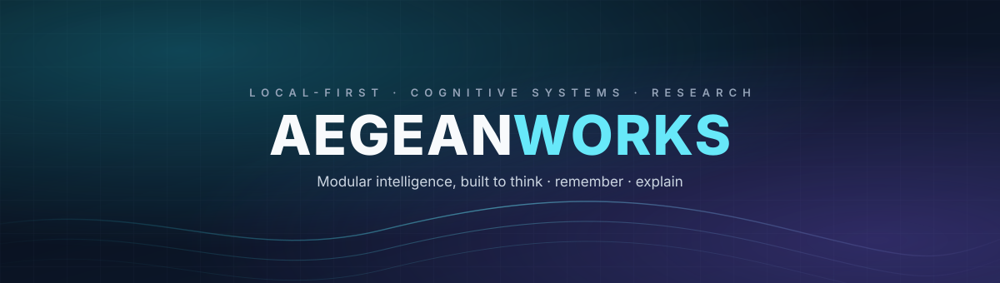

<p align="center">
  
</p>

<p align="center">
  <a href="https://aegeanworks.github.io/AegeanWorks/"></a>
  <a href="https://github.com/AegeanWorks/AIKit"></a>
  <a href="COMMERCIAL.md"></a>
  <a href="https://github.com/AegeanWorks?tab=repositories"></a>
</p>

<h3 align="center">We build software that thinks, remembers, and explains itself.</h3>

---

## What we build

AegeanWorks is an independent software studio working on **local-first AI systems**, **cognitive architecture**, and **computational research**. The work favors small composable parts, inspectable state, and software that still works when the network does not.

| Area | What it means in practice |
|---|---|
| **Cognitive systems** | Agent frameworks, tool routing, memory layers, and explicit belief control. |
| **Governed autonomy** | Delivery gates, audit trails, and disruption recovery for AI coding agents. |
| **Personal science** | N=1 experimentation, neuro-acoustics, and falsification-first research tooling. |
| **Playable systems** | Simulations, puzzles, and games built to make complex mechanics legible. |

---

## Featured systems

### [NeuroCore](https://github.com/AegeanWorks/NeuroCore)
A self-hosted, modular agent framework for persistent, tool-using autonomous systems. Workflows, long-term memory, RAG, and a plugin surface in one extensible runtime.

### [AIKit](https://github.com/AegeanWorks/AIKit)
Crash-resilient governance and delivery gates for AI coding agents: versioned task ledger, commit-level verification, secret scanning, and per-project gates.

### [N1-Engine](https://github.com/AegeanWorks/N1-Engine)
A local-first platform for rigorous personal N=1 experimentation — protocol logging, metabolic tracking, and hormonal optimization models.

### [NeuralBeat](https://github.com/AegeanWorks/NeuralBeat)
A mathematically precise neuro-acoustic desktop app for binaural, monaural, and isochronic tones, with hardware-aware safety limits.

---

## Public project atlas

Every project repository below is public. Browse the full set on [GitHub](https://github.com/AegeanWorks?tab=repositories).

<details>
<summary><b>Cognitive AI &amp; Agent Infrastructure</b></summary>

| Project | Description |
|---|---|
| [NeuroCore](https://github.com/AegeanWorks/NeuroCore) | Modular agent framework with workflows, memory, RAG, and plugins. |
| [AIKit](https://github.com/AegeanWorks/AIKit) | Governance, delivery gates, and recovery for AI coding agents. |
| [lacon](https://github.com/AegeanWorks/lacon) | An AI that thinks in as few letters as possible, recursively. |
| [lattice](https://github.com/AegeanWorks/lattice) | Provenance-first knowledge graph for humans and agents. |
| [assay](https://github.com/AegeanWorks/assay) | Tamper-evident audit evidence with hash-chained ledgers. |
| [aegean-licensing](https://github.com/AegeanWorks/aegean-licensing) | Dual-licensing framework and certificate verification tooling. |

</details>

<details>
<summary><b>Research &amp; Simulation</b></summary>

| Project | Description |
|---|---|
| [N1-Engine](https://github.com/AegeanWorks/N1-Engine) | Local-first, privacy-focused N=1 experimentation platform. |
| [fluid-universe](https://github.com/AegeanWorks/fluid-universe) | Falsification-first code testing a Z3 origin of the Koide relation. |
| [PNN](https://github.com/AegeanWorks/PNN) | Perineuronal-net softening and insulin signaling in obesity. |
| [primordia](https://github.com/AegeanWorks/primordia) | Zero-dependency evolution sandbox with exact seed replay. |
| [orrery](https://github.com/AegeanWorks/orrery) | Terminal N-body gravitational sandbox with live diagnostics. |
| [NeurologyClinicTemplates-TR](https://github.com/AegeanWorks/NeurologyClinicTemplates-TR) | Standardized Turkish neurology anamnesis templates. |

</details>

<details>
<summary><b>Health, Neuro &amp; Personal Tools</b></summary>

| Project | Description |
|---|---|
| [NeuralBeat](https://github.com/AegeanWorks/NeuralBeat) | Binaural, monaural, and isochronic tone generator. |
| [NeuroOptic](https://github.com/AegeanWorks/NeuroOptic) | Research-grade visual oscillator for brainwave entrainment. |
| [NeuralDeck](https://github.com/AegeanWorks/NeuralDeck) | Offline document-to-flashcard desktop app powered by local AI. |
| [NobetWizard](https://github.com/AegeanWorks/NobetWizard) | Fair, exportable duty-roster optimizer built with Streamlit. |
| [mnemo](https://github.com/AegeanWorks/mnemo) | Dependency-free spaced-repetition flashcard CLI. |
| [NoMoreClutter](https://github.com/AegeanWorks/NoMoreClutter) | AI-powered desktop file organizer. |

</details>

<details>
<summary><b>Developer Tools &amp; Utilities</b></summary>

| Project | Description |
|---|---|
| [chronos](https://github.com/AegeanWorks/chronos) | Local-first focus and session orchestrator. |
| [gauge](https://github.com/AegeanWorks/gauge) | Zero-dependency terminal ruler for numeric series. |
| [tally](https://github.com/AegeanWorks/tally) | Dependency-free expense ledger for the terminal. |
| [tempo](https://github.com/AegeanWorks/tempo) | Local focus timer with no account and no network calls. |
| [pebble](https://github.com/AegeanWorks/pebble) | Tiny dependency-free scripting language, built as an AIKit evaluation. |
| [photo-harbor](https://github.com/AegeanWorks/photo-harbor) | Self-hosted Windows photo server for iPhone Shortcuts. |
| [muse](https://github.com/AegeanWorks/muse) | Prompt-driven AI music creation with automated listening scores. |
| [ui-sandbox](https://github.com/AegeanWorks/ui-sandbox) | Small React + Vite surface for exercising AIKit's UI guard. |

</details>

<details>
<summary><b>Games &amp; Playable Experiments</b></summary>

| Project | Description |
|---|---|
| [aldervale](https://github.com/AegeanWorks/aldervale) | 2.5D medieval RPG rendered in tiny ASCII cells. |
| [MemoryReconstruction](https://github.com/AegeanWorks/MemoryReconstruction) | Action-roguelike metroidvania about rebuilding a lost world. |
| [crypt-crawler](https://github.com/AegeanWorks/crypt-crawler) | Tactical turn-based web dungeon crawler. |
| [cyberpulse](https://github.com/AegeanWorks/cyberpulse) | Retro-cyberpunk terminal hacking simulation. |
| [fold](https://github.com/AegeanWorks/fold) | Local 4x4 tile-merge game with no dependencies or accounts. |
| [prism-relay](https://github.com/AegeanWorks/prism-relay) | Neon light-routing puzzle with mirrors, prisms, and receivers. |
| [voidfarer](https://github.com/AegeanWorks/voidfarer) | Autonomous deep-space fleet and procedural galaxy simulator. |

</details>

---

## Research threads

- **Obesity and incretin regulation** — GLP-1 signaling, hypothalamic circuitry, and falsifiable mechanistic models.
- **Memory integrity** — how agents store, revise, and falsify beliefs without drifting.
- **Neuro-acoustics** — precise entrainment, perceptual safety, and measurable outcomes.
- **Computational cosmology** — lepton mass relations and fluid analogies, kept clearly separated from speculation.
- **Consciousness engineering** — architecture questions treated as engineering constraints, not decoration.

---

## Philosophy

> **Local-first over API dependency.**  
> **Modular over monolithic.**  
> **Structured cognition over prompt chaos.**  
> **Falsification over confident prose.**

---

## Toolbox

<p>
  
  
  
  
  
  
</p>

---

## License

Current releases are free for personal use under a license per domain: AL-1.1 for software, AGL-1.1 for games, and ASL-1.1 for research. Commercial use of those releases needs the Aegean Commercial License 1.0 (ACL-1.0); see [COMMERCIAL.md](COMMERCIAL.md). Versions already published under GNU AGPL-3.0 keep that grant, including its commercial permissions. The canonical texts and tier table live in the [license catalog](https://github.com/AegeanWorks/aegean-licensing/blob/master/licenses/CATALOG.md).

---

## Connect

- **Website** — [aegeanworks.github.io/AegeanWorks](https://aegeanworks.github.io/AegeanWorks/)
- **GitHub** — [@AegeanWorks](https://github.com/AegeanWorks)
- **X** — [@Aegean_E](https://twitter.com/Aegean_E)
- **Commercial licensing** — [aegean-licensing@proton.me](mailto:aegean-licensing@proton.me)

<p align="center"><sub>Built in public, one inspectable system at a time.</sub></p>

---

## Cold-Start Quick Reference

- **Runtime Prerequisites**: Git 2.30+ and Python 3.10+ (standard library only).

**Canonical Regression Shield Gate**:
```bash
python -m unittest discover -s tests
```

The same suite runs in GitHub Actions on every push and pull request (`.github/workflows/tests.yml`).

### What's Inside

```text
AegeanWorks/
├── README.md                <- Profile and public project atlas
├── LICENSE                  <- Aegean License 1.1 (AL-1.1): free personal use
├── COMMERCIAL.md            <- Licensing tiers and ACL-1.0 commercial terms
├── .gitignore               <- Git and AIKit transient-state exclusions
├── assets/
│   └── banner.svg           <- Profile banner
├── docs/                    <- Static GitHub Pages site and its assets
├── .github/
│   ├── FUNDING.yml          <- Sponsorship configuration
│   └── workflows/
│       └── tests.yml        <- CI regression gate on every push
├── .aikit/
│   ├── project.json         <- Project identity and test command
│   ├── guidelines.md        <- Project-only rules
│   ├── decisions.md         <- ADR register
│   ├── codebase_map.md      <- Generated AST symbol catalog
│   └── task_ledger.json     <- Delivery ledger
└── tests/
    └── test_profile.py      <- Content and link integrity tests
```


